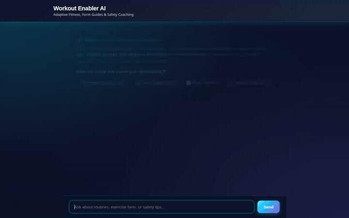

# ⚡ Workout Enabler AI Assistant

[](https://github.com/google/adk)
[](https://github.com/google/a2a)
[](https://github.com/google/a2ui)

**Workout Enabler** is an adaptive, safety-first personal fitness coach and exercise assistant built with the **Google Agent Development Kit (ADK)** and deployed on **Google Cloud Agent Platform**. It creates tailored fitness routines, demonstrates proper exercise form, enforces physical limitation safety, calculates biomechanical metrics in Python sandboxes, and stores durable long-term memory across sessions.



---

## 🚀 Key Features & Capabilities

### 🧠 Cross-Session Memory & Personalization
- **Vertex AI Memory Bank**: Automatically extracts and remembers long-term user context across sessions (such as past injuries, equipment constraints, age, weight, and rest preferences).
- **Physical Limitation & Injury Enforcement**: Prioritizes user safety by enforcing joint/injury constraints (e.g. knee pain, lower back sensitivity, shoulder impingements) across all generated plans.

### 🏋️ Intelligent Fitness Coaching & Workouts
- **Personalized Routine Generator**: Tailors multi-day strength and cardio training splits to user age, weight, gender, experience level, and physical constraints.
- **Database-Grounded Exercise Guides**: Queries Google Cloud Firestore for exercise steps, targeted muscle groups, and safety tips.
- **Workout Logging & History**: Records completed sessions (exercise, sets, reps, weight) to Firestore and retrieves historical performance logs.
- **Rest Window & Inactivity Tracking**: Checks hours elapsed since the last logged session against user recovery preferences.

### 🎨 Visual & Media Generation
- **AI Image Generation**: Generates custom workout and exercise visuals on-demand using Google's `gemini-3.1-flash-lite-image` model in the `global` region.
- **Omni Video Generation**: Generates short exercise motion videos using Google's `gemini-omni-flash-preview` model via the GenAI Interactions API in the `global` region.
- **Public Cloud Storage Artifacts**: Saves media artifacts directly to Google Cloud Storage (`storage.googleapis.com`) and registers them with ADK `ToolContext` for the Agent Playground Artifacts panel.

### 🧮 Python Code Sandbox & Biomechanical Metrics
- **Agent Engine Sandbox**: Executes isolated Python code via `AgentEngineSandboxCodeExecutor` to calculate:
  - 1-Rep Max (1RM) using Epley & Brzycki formulas
  - Target Heart Rate Zones (Karvonen formula)
  - Body Mass Index (BMI) & Basal Metabolic Rate (BMR)

### 🖥️ Native A2UI Visual Cards
- **A2UI Integration**: Renders agent responses as rich visual display cards, vertical columns, horizontal rows, and embedded image components using ADK's `a2ui_callback`.

---

## 🛠️ Google Cloud & AI Technology Stack

| Service / Component | Role & Implementation |
| :--- | :--- |
| **Google Agent Development Kit (ADK 1.1.0)** | Core agent logic, tool binding, callbacks (`a2ui_callback`, `generate_memories_callback`), and app orchestration |
| **Gemini 2.5 Flash** | Primary reasoning model (`gemini-2.5-flash`) for multi-tool orchestration and conversation |
| **Gemini 3.1 Flash Lite Image** | On-demand exercise image generation (`gemini-3.1-flash-lite-image`) |
| **Gemini Omni Flash Preview** | Omni video generation (`gemini-omni-flash-preview`) in the `global` region |
| **Vertex AI Memory Bank** | Durable long-term memory extraction and recall (`VertexAiMemoryBankService`) |
| **Google Cloud Firestore** | NoSQL database for exercise catalogs, workout routines, user profiles, and session logs |
| **Google Cloud Storage** | Media asset storage for generated exercise images and video clips |
| **Agent Engine Code Executor** | Isolated Python execution sandbox for biomechanical metric calculations |
| **Agent-to-Agent (A2A) Protocol** | Proxy-to-Agent streaming communication over standard A2A data parts |

---

## 🛠️ Project Structure

```text
workout-enabler/
├── app/
│   ├── __init__.py           # ADK App entrypoint
│   ├── agent.py              # Root agent configuration, tools, and system instructions
│   └── a2ui_utils.py         # A2UI response serialization callbacks
├── frontend/
│   ├── main.py               # FastAPI proxy server (talks A2A to deployed agent)
│   └── static/
│       └── index.html        # Glassmorphic chat interface & A2UI card renderer
├── agents-cli-manifest.yaml  # Agent deployment configuration
├── seed_firestore.py         # Database seeder for exercise routines & guides
├── record_demo_video.py      # Playwright script for demo video recording & audio mixing
├── demo.gif                  # Demo walkthrough animation
├── Dockerfile                # Cloud Run container definition
└── pyproject.toml            # Dependencies and project metadata
```

---

## 💻 Local Setup & Execution Guide

### Prerequisites
- Python 3.11+
- `gcloud` CLI authenticated to Google Cloud project
- Google Cloud Project with Vertex AI, Firestore, and Cloud Storage enabled

### 1. Environment Setup

Clone the repository and install dependencies:

```bash
python3 -m venv .venv
source .venv/bin/activate
pip install -r requirements.txt  # or uv sync
```

Set required environment variables:

```bash
export GOOGLE_CLOUD_PROJECT="your-gcp-project-id"
export GOOGLE_CLOUD_LOCATION="us-east1"
```

### 2. Seed Database (Optional)

Populate Firestore with initial exercise catalog items and routines:

```bash
python seed_firestore.py
```

### 3. Run Agent Locally via ADK Web

Launch the ADK developer UI:

```bash
adk web app
```

### 4. Run Custom Frontend & FastAPI Proxy

To run the custom chat interface locally:

```bash
cd frontend
python main.py
```

Open a web browser and navigate to the local server address output by Uvicorn.

---

## ☁️ Deployment Instructions

### Deploy Agent to Agent Runtime

Deploy the ADK agent container to Google Cloud Agent Platform using `agents-cli`:

```bash
agents-cli deploy --no-confirm-project
```

### Deploy Frontend Proxy to Cloud Run

Deploy the FastAPI proxy and static frontend to Google Cloud Run:

```bash
gcloud run deploy workout-enabler-frontend \
  --source ./frontend \
  --region us-east1 \
  --allow-unauthenticated \
  --set-env-vars AGENT_ENGINE_RESOURCE_NAME="projects/<project-number>/locations/us-east1/reasoningEngines/<engine-id>",AGENT_DIRECTORY="app"
```

---

## 📋 Status & Future Enhancements

- [x] Vertex AI Memory Bank long-term memory persistence
- [x] Firestore workout logging and exercise catalog lookups
- [x] AI image & Omni video generation tools
- [x] Agent Engine Python sandbox metric calculation
- [x] Native A2UI response card rendering
- [x] Custom FastAPI A2A proxy and responsive frontend UI
- [ ] *Planned*: Asynchronous background push notifications via Cloud Tasks / Cloud Scheduler for rest window alerts
